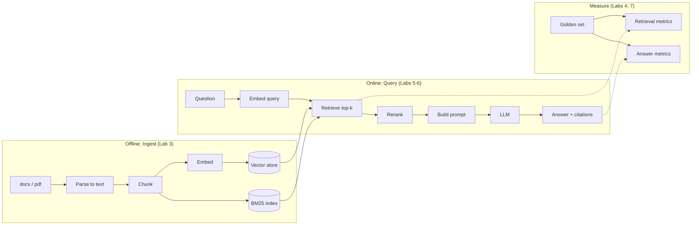
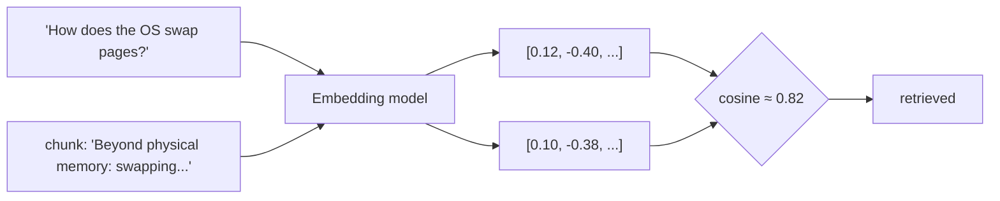
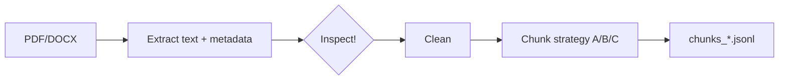
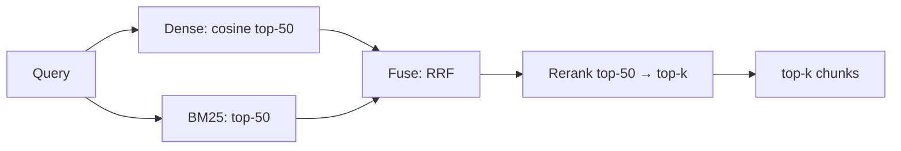
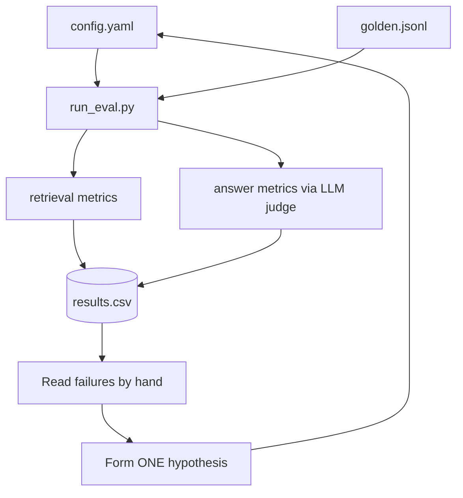

# Local RAG Lab: Tokens → Embeddings → Retrieval → Eval → Tuning

**Rules of this lab**
- You build every piece. Skeletons have `TODO`s; no full solutions.
- Each lab ends with **questions**. Write your answers in `journal.md` *before* moving on.
- Change **one variable at a time**. Log every run.
- Stuck >30 min? Paste your code + error back to Claude and ask for a hint, not the answer.

---

## Requirements (check before Lab 0)

| Area | Need | You |
|---|---|---|
| Hardware | Apple Silicon, 16GB+ RAM, ~30GB free disk | M4 / 36GB ✅ |
| Software | macOS, Homebrew, Python 3.11+, `uv`, Ollama, git, VS Code | install in Lab 0 |
| Python | functions, lists/dicts, loops, reading JSON, pip/uv | "OK" level is enough |
| Terminal | `cd`, `ls`, running scripts, env vars | basic |
| Math | dot product, "angle between two vectors" intuition | that's all |
| Data | 20–60 docs **you understand well enough to judge answers** | critical |
| Time | ~15–20 hrs total; Lab 4 alone ~3 hrs | |

Not needed: ML training, GPUs, PyTorch knowledge, LangChain.

---

## The map



Where each concept lives:

| Concept | Where it bites you |
|---|---|
| Tokenization | chunk size, context window, cost/latency, silent truncation |
| Embeddings | what "similar" means, query vs doc mismatch |
| Chunking | what can be retrieved at all |
| Retrieval | whether the right text reaches the LLM |
| Generation | whether the LLM uses it faithfully |
| Eval | whether any of your changes actually helped |

---

## Your corpus: networking/DNS, <50 files

What changes for you:
- **Tokens:** IPs, CIDR, IPv6, FQDNs, `dig` flags, and MACs split badly. Lab 1 has these pre-loaded.
- **Embeddings:** `enable/disable` and `allow/deny` may score as near-identical. In DNS that is a wrong answer, not a near miss. Lab 2 tests it.
- **Parsing:** watch for parameter tables, CLI output blocks, and version notes. Add a `version` field if docs cover multiple releases.
- **Golden set:** add types `cli` (exact command), `config_value` (defaults, ports, limits), and `version` (answer depends on release).
- **Prediction to test:** BM25 will beat dense search on exact identifiers. Hybrid should win overall. Prove or disprove it.
- **Scale:** numpy brute-force search is enough; skip Chroma. A full eval run takes minutes, so sweep freely.
- **Starter code:** `rag-lab/`. Plumbing is done; core logic is `TODO`. Index and search live in `retrieve.py`; metrics and the judge live in `run_eval.py`.

---

## Corpus v2: OS + Networking + Databases + System Design

**Sources** (free; keep local copies private, don't redistribute)

| Domain | Source | Format | License / note |
|---|---|---|---|
| OS | Operating Systems: Three Easy Pieces (OSTEP) | PDF per chapter | free; authors ask you to link, not re-host. $10 full PDF supports them |
| Networking | Computer Networks: A Systems Approach | HTML / RST on GitHub | CC BY 4.0 |
| Networking | DNS RFCs 1034, 1035 (+ any your docs cite) | TXT / PDF | public |
| Databases | CMU 15-445 lecture notes + slides | PDF per lecture | free course material |
| Databases | PostgreSQL manual (pick chapters: MVCC, indexes, WAL) | PDF, versions 13–18 | open; the full manual is ~3000 pages, so don't ingest it all |
| Databases | "Architecture of a Database System" (Hellerstein et al.) | PDF paper | free |
| System design | system-design-primer (donnemartin) | Markdown | CC BY 4.0 |
| System design / SRE | Google SRE book + Workbook | HTML | free to read online |

**Suggested size:** ~8–12 files per domain → 40–50 files total. Small enough to inspect by hand.

**Folder layout:** `data/raw/<domain>/...` → parser sets a `domain` field automatically.

**What this changes in the labs**
- ⚠️ **Training-data leak:** these textbooks are almost certainly in the LLM's training data. It can answer *without* retrieval → your eval looks great even if retrieval is broken.
  - Run the closed-book baseline (Lab 6, exp. 6).
  - Write questions on *specific details*: a figure's numbers, a lecture's example, a chapter's exact claim.
- **Cross-domain ambiguity, your best new test.** Same word, different meaning:
  - "log": DB write-ahead log vs OS journaling vs SRE logging
  - "consistency": ACID vs CAP vs cache coherence
  - "page": OS memory page vs DB disk page
  - "partition": network partition vs table partitioning
  - Add golden type `ambiguous`. Test whether filtering by `domain` metadata fixes it.
- **Format comparison:** Networks book (RST/HTML), primer (Markdown), and SRE book (HTML) have clean headings; PDFs don't. Compare chunk quality per format.
- **Version questions:** the PostgreSQL manual differs across 16 / 17 / 18. Use it for your `version` question type.

---

## Lab 0 — Setup (30 min)

```bash
# Ollama (app or brew)
brew install ollama
ollama serve            # separate terminal

# Models (fit easily in 36GB)
ollama pull qwen3:8b            # generator, fast
ollama pull qwen3:14b           # generator, smarter (compare later)
ollama pull nomic-embed-text    # embedder A
ollama pull bge-m3              # embedder B (multilingual)
ollama pull mxbai-embed-large   # embedder C

# Python project
brew install uv
uv init rag-lab && cd rag-lab
uv add ollama tiktoken transformers pymupdf python-docx numpy pandas \
       chromadb rank-bm25 sentence-transformers matplotlib
```

Folder layout:

```
rag-lab/
  data/raw/          # your docx + pdf
  data/parsed/       # extracted text (jsonl)
  data/chunks/       # chunk files per strategy
  eval/golden.jsonl  # your test questions (Lab 4)
  runs/results.csv   # one row per experiment
  src/
  journal.md
```

✅ Checkpoint: `ollama list` shows all models; `uv run python -c "import ollama; print(ollama.embed(model='nomic-embed-text', input='hi')['embeddings'][0][:5])"` prints 5 floats.

---

## Lab 1 — Tokenization

> **Why this matters**
> - Models never see words. They see token IDs.
> - Every limit is counted in tokens: context window, embedding max input, speed.
> - Count wrong → chunks get cut mid-thought, prompts get silently truncated, answers degrade with no error.

**Goal:** feel what a token is and why counts differ.

**Build** `src/tokens.py`:

```python
import tiktoken, ollama
from transformers import AutoTokenizer

samples = {
    "english": "...",      # TODO: a normal paragraph from your docs
    "jargon":  "...",      # TODO: acronyms / product names from your docs
    "table":   "...",      # TODO: a table row as extracted from a PDF
    "code":    "...",      # TODO: a config or code snippet
    "numbers": "IP 10.120.4.255, version 3.14.159, $1,234,567.89",
}

gpt = tiktoken.get_encoding("cl100k_base")
qwen = AutoTokenizer.from_pretrained("Qwen/Qwen3-8B")   # downloads tokenizer only

for name, text in samples.items():
    # TODO: count tokens with gpt and qwen
    # TODO: print the actual token pieces for qwen (convert ids back to strings)
    # TODO: get Ollama's count: ollama.generate(model="qwen3:8b", prompt=text,
    #       options={"num_predict": 1}) -> look at 'prompt_eval_count'
    # TODO: print chars, words, tokens, chars/token ratio
    pass
```

**Experiments**
1. Which sample has the worst chars/token ratio? Look at the pieces — why?
2. Does Ollama's count match the HF tokenizer exactly? If not, what's the extra?
3. **Truncation trap:** build a ~12k-token prompt (paste a long doc), put a question at the *end*. Call with default options, then with `options={"num_ctx": 16384}`. Compare `prompt_eval_count` and the answers.
4. Find the max input length of each embedding model (`ollama show nomic-embed-text`). Embed text longer than that. Error, or silent?

**Questions → journal**
- Should chunk size be measured in chars, words, or tokens? Whose tokenizer?
- What happens to a RAG system if context is silently truncated? How would you even detect it?

---

## Lab 2 — Embeddings

> **Why embeddings exist**
> - The LLM can't read your whole corpus per question: context is limited, slow, and attention degrades with length.
> - So you must *find* the 3–10 relevant chunks first.
> - Keyword search misses meaning: "RPZ" vs "response policy zone", "page cache" vs "buffer cache", "crash recovery" vs "WAL replay".
> - An embedding model turns text into a vector (e.g. 768 numbers). Similar meaning → vectors point in similar directions.
> - Chunks are embedded once (offline). Each query is embedded at runtime (milliseconds). Search = find the closest vectors.
> - Known weak spots: negation, exact identifiers, numbers, versions. That's why Lab 5 adds BM25.



**Goal:** learn what "similar" means to a model — and where it lies.

**Build** `src/embed_play.py`:

```python
import numpy as np, ollama

def embed(texts, model):
    # TODO: call ollama.embed, return np.array
    ...

def cos_matrix(a, b):
    # TODO: normalize rows, return a @ b.T
    ...

pairs = [
    # TODO: write ~15 sentence pairs from YOUR domain, covering:
    # paraphrase (same meaning, different words)
    # keyword overlap (same words, different meaning)
    # negation ("X supports Y" vs "X does not support Y")
    # question vs the passage that answers it
    # unrelated (baseline)
]
# TODO: for each model in [nomic-embed-text, bge-m3, mxbai-embed-large]:
#   print dimension, time per 100 embeddings, similarity per pair
#   plot a heatmap (matplotlib imshow)
```

**Experiments**
1. Negation pairs: how close are they? Is that a problem for your domain?
2. Is cosine 0.75 "high"? Compute similarity of 50 *random unrelated* pairs per model. Plot histograms. Compare models.
3. **Prefix test (nomic):** embed queries as `"search_query: ..."` and docs as `"search_document: ..."` vs no prefix. Does question→answer similarity change? Look up whether your other models want prefixes/instructions.
4. Same text embedded twice — identical vectors? Embedded in a batch vs alone?

**Questions → journal**
- Can you compare raw scores across models? Why/why not?
- Is a question semantically "similar" to its answer? What does that imply for retrieval?

---

## Lab 3 — Ingest & Chunk

> **Why chunking matters**
> - One chunk = one vector. A big chunk's vector is an *average* of many topics → blurry, matches nothing well.
> - A tiny chunk is precise but loses context ("it", "this setting", "the above").
> - The chunk is also what the LLM reads. If the answer is split across two chunks, retrieval must find both.
> - Garbage in parsing (repeated footers, broken tables) becomes garbage vectors.

**Goal:** see how much garbage hides in parsed docs, and how chunking decides what's findable.



**Build**
- `src/parse.py` → `data/parsed/docs.jsonl`, one record per page/section:
  `{doc_id, source, page, heading, text}`
  - PDF: `pymupdf` (`page.get_text()`), keep page numbers
  - DOCX: `python-docx`, use paragraph styles to capture headings
- **Open 5 parsed pages next to the originals.** List every defect you find (headers/footers repeated, broken tables, hyphenation, multi-column order, missing images text).
- `src/chunk.py` with 3 strategies, each writing its own file:
  - **A fixed:** N tokens, M overlap (start 512/64)
  - **B structural:** split on headings/paragraphs, merge small ones up to a max
  - **C small-to-big:** small chunks (~128 tok) for search, store parent section for the LLM
- Every chunk keeps: `chunk_id, doc_id, source, page, heading, text, n_tokens`

**Experiments**
1. Histogram of `n_tokens` per strategy. Any chunks with ~5 tokens? ~5000?
2. Pick a fact you know is in the docs. Which chunk contains it under each strategy? Is it split across two?
3. Try prepending `heading` (or doc title) to the chunk text before embedding. Keep it as strategy **B+** for Lab 5.

**Questions → journal**
- Which parse defects will hurt retrieval most? Which can you ignore?
- Smaller chunks = more precise or more lost context? (Answer after Lab 5 numbers, not now.)

---

## Lab 4 — Build the Golden Set (do this BEFORE tuning)

> **Why a golden set**
> - RAG fails *silently*: wrong answers sound as confident as right ones.
> - Without fixed questions + expected sources, every "improvement" is a guess.
> - It's also how you find *where* it breaks: retrieval vs generation.

**Goal:** a test set so "better" means a number, not a vibe.

`eval/golden.jsonl`, 40–60 items:

```json
{"id": "q01", "question": "...", "answer": "...", "source": "file.pdf", "pages": [12], "type": "lookup"}
```

Mix of `type`:
- `lookup` — single fact, one chunk
- `jargon` — uses acronyms/synonyms not in the text
- `multi` — needs 2+ chunks / docs
- `compare` — "difference between X and Y"
- `table` — answer lives in a table
- `none` — answer is NOT in the docs (tests "I don't know")

Tips
- You can have the LLM *draft* questions from random chunks, but you must verify and edit each one. LLM-drafted questions copy the chunk's wording → too easy.
- Write some questions the way a real user would: vague, misspelled, short.

**Question → journal**
- Which `type` do you predict will fail most? (Check after Lab 5.)

---

## Lab 5 — Retrieval

> **Why dense + BM25 + rerank**
> - **Dense (embeddings):** matches meaning, weak on exact strings.
> - **BM25 (keywords):** matches exact terms (`fsync`, `SO_REUSEADDR`, `10.0.0.0/8`), blind to synonyms.
> - **Hybrid (RRF):** merges both rankings; covers each one's blind spot.
> - **Reranker (cross-encoder):** reads query + chunk *together*, so it's far more precise but slow. Use it only on the top ~50 candidates.
>
> | | Bi-encoder (embedding) | Cross-encoder (reranker) |
> |---|---|---|
> | Input | query and chunk separately | query + chunk together |
> | Speed | precompute chunks, ms/query | runs per pair, slow |
> | Precision | coarse | fine |
> | Role | recall: find candidates | precision: order them |

**Goal:** get the right chunk into the top-k. Measure it.



**Build in this order** (measure after each step):
1. `src/index.py` — embed chunks, save as `.npy` + metadata. **Brute-force numpy search first.** Then move to Chroma and confirm same results.
2. `src/eval_retrieval.py` — for each golden question, is a chunk from the right `source`+`page` in top-k?
   - Metrics: `hit@1, hit@5, hit@10, MRR`, broken down by `type`
3. BM25 with `rank_bm25` (you decide tokenization — lowercase? stopwords? → ties back to Lab 1)
4. Hybrid via Reciprocal Rank Fusion: `score = Σ 1/(60 + rank)`
5. Reranker: `sentence_transformers.CrossEncoder("BAAI/bge-reranker-v2-m3")` on MPS

**Experiment matrix** (one change per run, log to `runs/results.csv`):

| run | chunks | embedder | prefix | search | rerank | hit@5 | MRR | ms/query |
|---|---|---|---|---|---|---|---|---|
| r01 | A 512/64 | nomic | no | dense | no | | | |
| r02 | A 512/64 | nomic | yes | dense | no | | | |
| r03 | B | ... | | | | | | |
| ... | | | | | | | | |

**Questions → journal**
- Which single change gave the biggest jump? Which did nothing?
- Which question `type` does BM25 win? Dense? Why?
- Look at 5 failures by hand. Is it a chunking, embedding, or golden-set problem?

---

## Lab 6 — Generation

> **Why grounding + citations**
> - The LLM will fill gaps from its training memory, mixing real context with guesses.
> - Citations make every claim checkable and let you detect when the model ignored the context.
> - "Not in documents" is a feature: a confident wrong answer is worse than none.

**Goal:** make the LLM answer *only* from retrieved context, with citations.

**Build** `src/answer.py`:
- Prompt template: system rules + numbered chunks `[1] (source p.12) ...` + question
- Require citations like `[1][3]`; require "not in documents" when unsupported
- Set `num_ctx` explicitly (Lab 1!) and log `prompt_eval_count` per call

**Experiments**
1. k = 3 vs 5 vs 10. Does more context help or hurt?
2. **Ordering:** put the correct chunk first vs middle vs last of 10.
3. `none`-type questions: how often does it hallucinate? Change only the prompt and retest.
4. qwen3:8b vs qwen3:14b: quality vs tokens/sec.
5. Temperature 0 vs 0.7, same question 5 times.
6. **Closed-book baseline:** answer every golden question with NO context. If the score is already high, the model knows the topic from training and your RAG eval is inflated.

---

## Lab 7 — Answer Evaluation & Tuning Loop

> **Why separate metrics + a checked judge**
> - Retrieval metrics tell you if the right text arrived. Answer metrics tell you if the model used it. You need both to locate the bottleneck.
> - An LLM judge is fast but biased (likes long answers, its own style). Verify it against your own grades before trusting its numbers.

**Goal:** score answers automatically, but trust the judge only after checking it.



**Build**
- `config.yaml` holds every knob (chunk strategy, embedder, k, rerank, model, temperature, num_ctx, prompt version)
- `run_eval.py` reads config, runs all golden questions, appends one row to `results.csv`, saves per-question outputs to `runs/<run_id>/`
- LLM judge (use qwen3:14b) scoring each answer:
  - **correctness** vs your reference answer (0/1/2)
  - **faithfulness**: every claim supported by retrieved chunks? (0/1)
  - **citation valid**: cited chunks actually contain the claim? (0/1)
- **Judge the judge:** grade 15 answers yourself, compare with the LLM judge. Agreement %?

**Questions → journal (final)**
- Where is your bottleneck: retrieval or generation? How do you know?
- Can faithfulness be high while correctness is low? Find an example.
- What's your best config? What did it cost in latency?
- Which 3 knobs would you tune first on a *new* corpus, and in what order?

---

## journal.md template

```markdown
## Lab N — date
**Hypothesis:** 
**Changed:** (one thing)
**Result:** (numbers, run id)
**Surprise:** 
**Conclusion:** 
```

## Stretch (only after Lab 7)
- Query rewriting / HyDE (LLM writes a fake answer, embed that)
- Contextual chunk headers generated by an LLM per chunk
- Swap vector store (LanceDB) and confirm metrics don't change
- Try `ragas` and compare its scores with your own judge
